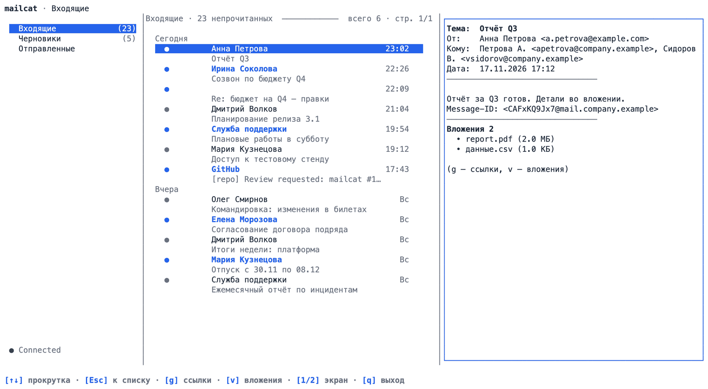
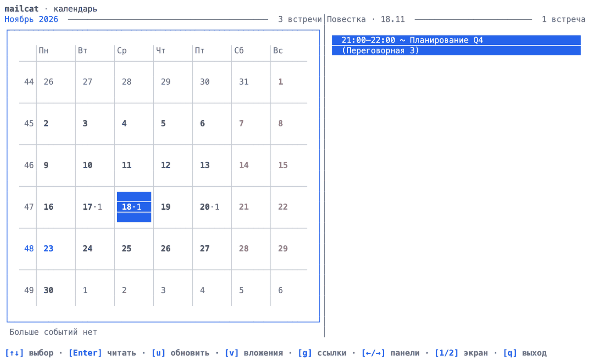

# mailcat

Read-only клиент корпоративной почты и календаря (on-premises Microsoft
Exchange) для macOS. Go + TUI (tview). Ничего не отправляет, не удаляет и не
меняет: только чтение.

## Возможности

- Почта: три панели (папки / список / просмотр), пагинация, непрочитанные,
  полноэкранные детали письма
- Календарь: месячная сетка + повестка дня, детали встреч (организатор,
  участники, ваш статус ответа)
- Вложения: сохранение в `~/Downloads/mailcat/`, открытие во временной копии;
  лимит размера; предупреждение об опасных расширениях
- Анти-фишинг: метка `[ВНЕШН]`, реальный адрес отправителя, реестр ссылок
  `[N] host` с пометками `⚠` (текст ≠ адрес) и `[IDN]` (punycode-домены)
- Уведомления macOS о новых письмах (по правилам из конфига)
- Диагностика: `mailcat doctor` — TCP → TLS → аутентификация → папки

## Скриншоты

Почта: папки, двухстрочный список писем и открытое письмо в правой панели.



Календарь: месячная сетка с номерами недель, «Ближайшее» и повестка дня.



## Запуск

Порядок действий (нужен Go ≥ 1.24 и macOS; команды — из корня репозитория):

1. Сборка и установка:

   ```sh
   go build -o mailcat ./cmd/mailcat
   sudo mkdir -p /usr/local/bin && sudo mv mailcat /usr/local/bin
   ```

   Обновление после изменений в коде — те же две команды (`mv` перезапишет
   старый бинарник; без пересборки запускается прошлая версия).

2. Конфиг — скопировать образец, выставить права, заполнить `server`,
   `username`, `org_domains` (при внутреннем сертификате сервера — `ca_path`):

   ```sh
   mkdir -p ~/.config/mailcat && chmod 700 ~/.config/mailcat
   cp config.example.toml ~/.config/mailcat/config.toml
   chmod 600 ~/.config/mailcat/config.toml
   ```

3. Root-CA при внутреннем сертификате: PEM → `~/.config/mailcat/company-root-ca.pem`
   (путь уже указан в образце конфига).

4. Пароль в Keychain (логин — `username` из конфига; если записи нет,
   `doctor` сам предложит её создать):

   ```sh
   security add-generic-password -a 'ваш_логин' -s mailcat -w
   ```

5. Проверка (при включённом VPN):

   ```sh
   mailcat doctor
   ```

6. Запуск:

   ```sh
   mailcat run        # 1 — почта, 2 — календарь, q — выход
   mailcat folders    # smoke-тест без TUI: список папок в stdout
   ```

Клавиши в TUI: `↑/↓` навигация · `Enter` письмо/встреча · `Tab`/`←/→` панели ·
`u` обновить · `g` ссылки · `v` вложения (`s` сохранить, `o` открыть) ·
`n/p` месяц · `Esc` назад.

## FAQ

- **«Сервер недоступен, похоже VPN выключен»** — Exchange виден только из
  корпоративной сети: включите VPN, затем `mailcat doctor`.
- **«Сертификат не прошёл проверку»** — укажите корректный `ca_path`
  (PEM корпоративного root-CA). Обход проверки сертификата невозможен.
- **HTTP 403 / ErrorAccessDenied** — EWS может быть отключён политикой для
  вашего ящика: спросите ИТ-отдел.
- **Почему не Mail.app?** — read-only без риска случайных действий, видимый
  реальный адрес отправителя и ссылки (анти-фишинг), лёгкий TUI через VPN.

## Безопасность

Подробности — `docs/SECURITY.md` (обязательный чек-лист проекта): изоляция
TLS-доверия, санитизация всего текста из EWS, пароль только в Keychain,
read-only whitelist операций EWS.

## Структура

```
cmd/mailcat/        точка входа: run (TUI), doctor, folders
internal/config/    TOML-конфиг, значения по умолчанию, валидация
internal/ews/       SOAP-клиент Exchange (только чтение) и фикстуры
internal/mail/      доменные модели почты и календаря, конвертация из EWS
internal/security/  санитизация текста из EWS и анти-фишинг
internal/notify/    правила уведомлений и фоновый watcher
internal/platform/  обвязка macOS: /usr/bin/open, файловый лог
internal/ui/        экраны tview (почта, календарь), палитра — theme.go
docs/               планы итераций, архитектура, EWS, безопасность, тесты
scripts/check.sh    gofmt, vet, build, test
```

## Разработка

Разработка идёт итерациями: текущая — `docs/PLAN-ITER3.1.md` (доработка
визуала по структурному референсу), выполненные — `docs/PLAN-ITER3.md`
(итерация 3), `docs/PLAN-ITER2.md` (итерация 2) и `docs/PLAN.md`
(итерация 1, история).
Ход работ и решения агента — `CHANGELOG.md` (запись на каждую задачу);
формат планов итераций — `docs/PLAN-TEMPLATE.md`.
Архитектура — `docs/ARCHITECTURE.md`, точные SOAP-шаблоны —
`docs/EWS-REFERENCE.md`, тесты — `docs/TESTING.md`. Практики работы с
ИИ-агентами, собранные за итерации, — `docs/AI-AGENT-PRACTICES.md`
(самодостаточный документ, можно делиться). Релиз итерации — команда
`/release`: проверка DoD → security-ревью → merge `dev → main` после явного
подтверждения.

```sh
gofmt -l . && go vet ./... && go build ./... && go test ./...
```

Экономия токенов — привычки для человека:

- тривиальные правки (опечатки, переименования, форматирование) — руками в
  VS Code (`editor.formatOnSave` + gopls): руками это ноль токенов, агентом —
  целая сессия;
- обсуждения и планирование — вне кодинг-сессий: сессия получает задачу и
  возвращает отчёт;
- новая задача попадает в план только со спекой (файлы, символы, ожидаемое
  поведение) — тогда исследование происходит один раз в документе, а не в
  каждой открывающей её сессии;
- раз в несколько дней смотрите расход по сессиям в opencode: одна аномальная
  сессия обычно объясняет большую часть ушедшего лимита.
